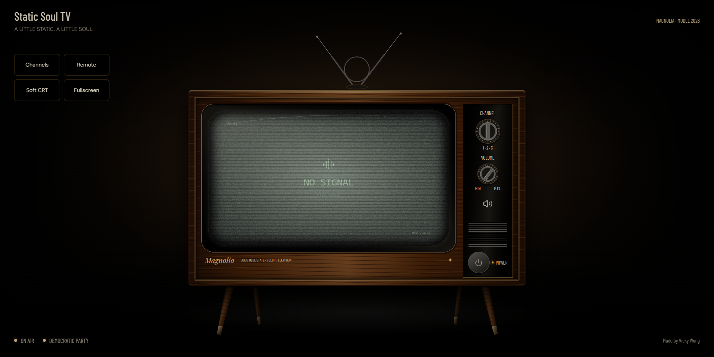
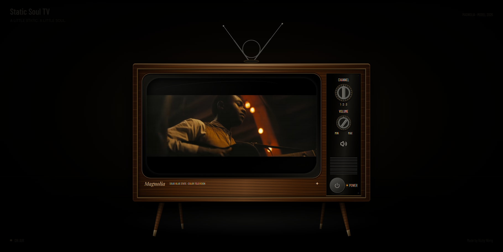
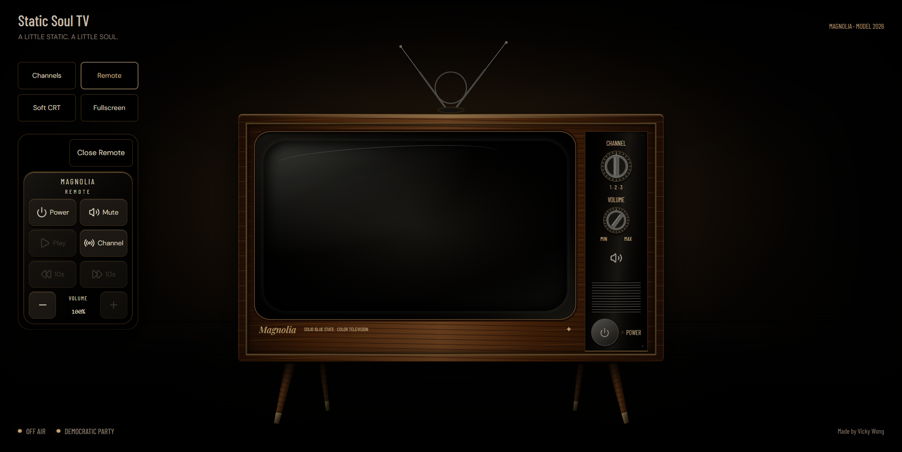

  <h1>📺 Static Soul TV</h1>

  

    A vintage television experience that brings analog texture and videos into a quiet room.
  

<h2>📑 Table of Contents</h2>

<ul>
  <li><a href="#objective">Objective</a></li>
  <li><a href="#inspiration">Inspiration</a></li>
  <li><a href="#project-details">Project Details</a></li>
  <li><a href="#experience">Experience</a></li>
  <li><a href="#how-to-use">How to Use</a></li>
  <li><a href="#details">Details</a></li>
  <li><a href="#tv">TV</a></li>
</ul>

<h2 id="objective">🎯 Objective</h2>

This project is a vintage television experience for watching videos through the lens of human stories and art. Set in a softly lit room with compact controls, the television takes center stage and keeps the focus on the screen. Created with Lovable, Gemini, ChatGPT, and Claude the experience brings the character of analog hardware with the intention of being human and authentic while keeping principles.

<h2 id="inspiration">✨ Inspiration</h2>

<table>
  <tr>
    <td>
      
    </td>
  </tr>
</table>

<table>
  <tr>
    <td>
        
      </a>
    </td>
  </tr>
</table>

  <ul>
    <li><a href="https://youtu.be/yneynem93s4?si=EPflvxbyt6FbpROI">Sinners by Ryan Coogler</a></li>
    <li><a href="https://youtu.be/3eL-XNmcuLQ?si=XdoMTtoX3355DSw2">Last Time (I Seen the Sun) by Alice Smith and Miles Caton</a></li>
    <li><a href="https://youtu.be/yGG1tSCoNbk?si=DZKxOonZFEmsnr6U">Sinators by Scott Colom for Scott Colom for Mississippi</a></li>  
    <li>Being human. Being a human storyteller.</li>

<h2 id="project-details">🛠️ Project Details</h2>

<strong>Tools:</strong> Lovable, Gemini, ChatGPT, Claude

<strong>Models:</strong> Gemini 4 Argon (2026), ChatGPT Sol 6.1 (2026), ChatGPT Astra 6, Claude Sonnet 5.5 (2026)

<strong>Format:</strong> Browser Video

<h2 id="experience">🛋️ Experience</h2>

Step into a dimly lit room and settle in front of a vintage television framed in warm walnut. Begin with a little static, add your own videos, and tune between three channels of your choosing. Open the remote to adjust the picture, then let the surrounding interface fade as you watch.

The visual direction pairs walnut cabinetry and warm tungsten lighting with tactile knobs and the familiar flicker of a CRT screen. Soft picture texture, static, and channel-switching transitions bring analog character to a modern viewing experience.

<h2 id="how-to-use">🎛️ How to Use</h2>

<ol>
  <li>Open the app and choose <strong>Channels</strong>.</li>
  <li>Add a YouTube video link or a direct HTTPS .mp4 or .webm video URL to one of the three channel slots.</li>
  <li>Save the link to tune in. If your browser requests it, tap the screen to begin playback.</li>
  <li>Use the television controls or open <strong>Remote</strong> to change channels, adjust volume, mute, or turn the TV on and off.</li>
  <li>Use the remote to play, pause, rewind, or fast-forward supported video.</li>
  <li>Switch between <strong>Soft CRT</strong> and <strong>Clean Picture</strong>, or enter <strong>Fullscreen</strong> where supported.</li>
</ol>

<h2 id="details">🔎 Details</h2>

  
<strong>Symbolism</strong>

  <ul>
    <li>Magnolia, state flower of Mississippi.</li>
    <li>Model 2026.</li>
    <li>Solid Blue State.
    <li>Color Television.</li>
  </ul>

  
<strong>Television &amp; Atmosphere</strong>

  <ul>
    <li>Scalable walnut cabinet with analog-style hardware.</li>
    <li>Warm room lighting and a widescreen video display.</li>
    <li>Static and CRT-style power and channel transitions.</li>
    <li>Optional soft CRT picture texture.</li>
    <li>Surrounding interface fades during uninterrupted viewing and returns with interaction.</li>
  </ul>

  
<strong>Channels &amp; Playback</strong>

  <ul>
    <li>Three editable channel slots.</li>
    <li>YouTube video links and direct HTTPS .mp4 or .webm URLs.</li>
    <li>Playback, volume, mute, power, and channel controls.</li>
    <li>Remote controls for play, pause, rewind, and fast-forward.</li>
    <li>URL validation, playback feedback, and retry options.</li>
  </ul>

  
<strong>Viewing Options</strong>

  <ul>
    <li>Responsive television layout for desktop and mobile screens.</li>
    <li>Collapsible Channels and Remote panels.</li>
    <li>Soft CRT and Clean Picture modes.</li>
    <li>Fullscreen viewing on supported browsers.</li>
  </ul>

  
<strong>Session &amp; Video Availability</strong>

  <ul>
    <li>Channel links and television settings stay in memory for the current visit. Refreshing restores the initial static screen.</li>
    <li>YouTube playback depends on the video's embedding permissions and availability.</li>
    <li>Direct video URLs must be accessible and playable in the browser.</li>
    <li>Autoplay, seeking, and fullscreen availability depend on the browser and video source.</li>
  </ul>

<h2 id="tv">📺 TV</h2>

  <a href="https://static-soul-tv.lovable.app/">Launch TV</a>

<h2 id="images">🖼️ Images</h2>

<h3>Static Screen</h3>

<table>
  <tr>
    <td>
      
    </td>
  </tr>
</table>

<h3>Sinners Movie Scene</h3>

<table>
  <tr>
    <td>
      
    </td>
  </tr>
</table>

</table>

<h3>Off Air</h3>

<table>
  <tr>
    <td>
      
    </td>
  </tr>
</table>

  

    <a href="https://github.com/redefiningvicky/redefiningvicky">
      Back to Portfolio
    </a>
  

